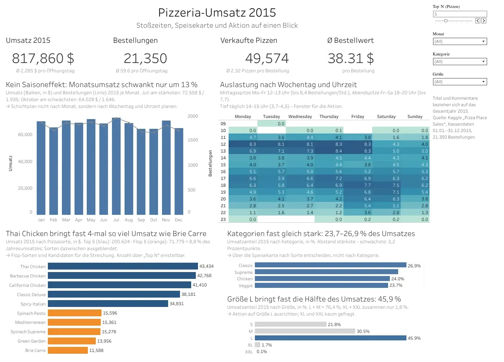

# 🍕 Revenue Analysis of a Pizzeria

**$817,860 revenue · 21,350 orders · avg. $38.31 per order**

Midterm project · Deutsche Tech Akademie · Data Analytics & Engineering
Analysis of a pizzeria's point-of-sale data for the year 2015 with SQL and Tableau.

## 1. Background and key questions

Laura Martinez took over a pizzeria in New Jersey at the end of the year and received the POS export for all of 2015. In January she has to make three decisions:

1. **Shift schedule** – no excess staff in quiet hours, no overload at peak times.
2. **Menu** – which pizzas can be dropped (too many items, ingredients spoil).
3. **Promotion** – when and with which promotion to strengthen weak days and hours.

To support these, the analysis answers eight key questions: key figures of the year · development by month · workload by weekday and hour · bestsellers and slow sellers · categories and sizes · candidates for removal · large orders · promotion.

## 2. Links

| What | Link |
| --- | --- |
| Dataset (Kaggle) | [Pizza Place Sales](https://www.kaggle.com/datasets/mysarahmadbhat/pizza-place-sales) |
| Dashboard (Tableau Public) | [Overview](https://public.tableau.com/views/pizza_dashboard_17908653158890/bersicht) |
| Story with recommendations (Tableau Public) | [Recommendations](https://public.tableau.com/views/pizza_dashboard_17908653158890/Empfehlungen) |
| Presentation (PDF) | [presentation/presentation.pdf](presentation/presentation.pdf) |
| Presentation (HTML) | [presentation/index.html](presentation/index.html) |
| SQL queries | [sql/queries.sql](sql/queries.sql) |

## 3. Data and tools

- 4 tables: `orders` (21,350 rows), `order_details` (48,620), `pizzas` (96), `pizza_types` (32)
- Period: 1 Jan 2015 – 31 Dec 2015, no missing values, no orphaned keys
- Selection for Tableau: VIEW `sales_lines` across all 4 tables, 1 row = 1 order line, 12 fields. Check: 48,620 rows = `order_details`
- **SQL**: SQLite Online – JOIN, CTE, window functions (`LAG`, `SUM() OVER`), VIEW
- **Visualization**: Tableau Public · **Submission**: GitHub

## 4. Answers to the 8 questions

### Q1: Key figures 2015
- Revenue **$817,860**, 21,350 orders, 49,574 pizzas
- Avg. order value **$38.31**, avg. 2.32 pizzas per order

### Q2: Development by month
- Strongest month: July with $72,558 revenue, weakest: October with $64,028
- No clear annual trend, gap of 13.3 %

### Q3: Workload by weekday and hour
- Strongest day: Friday (70.8 orders/day), quietest: Sunday (50.5)
- Peaks at 12–2 pm and 5–7 pm, quiet period 2–4 pm (4.1 orders per hour each)

### Q4: Bestsellers and slow sellers
- Highest-revenue pizza: Thai Chicken ($43,434), most sold: Classic Deluxe (2,453 units)
- Last place in both lists: Brie Carre ($11,589, 490 units)

### Q5: Categories and sizes
- Categories almost equal: 23.7 % to 26.9 % of revenue
- Size L brings 45.9 % of revenue, XL and XXL together only 1.8 %

### Q6: Candidates for removal
- Remove 4 pizzas: Brie Carre, Green Garden, Spinach Supreme, Mediterranean
- Affected: at most 6.87 % of revenue ($56,183); 6 ingredients do not appear in any other pizza

### Q7: Large orders (4+ pizzas)
- 18.2 % of orders bring 39.4 % of revenue; avg. order value $83.14 instead of $28.35
- Yes, a dedicated offer for companies is worth examining – the data does not show who is ordering

### Q8: Promotion
- "Afternoon Deal" daily 2–4 pm: pizza L at the price of M
- Revenue in this window today: $112,194 (13.7 %); +10 % = +$11,219 per year
- Cost of the discount (Q8b): 2,545 L pizzas in the window × price difference L–M = $9,929 per year
- Break-even at +8.9 % revenue growth in the window (9,929 / 112,194); at +10 % about $1,290 remain, before cost of goods

## 5. Three recommendations for Laura

1. **Shift schedule:** Align staffing with 12–2 pm and 5–7 pm, reinforce on Fridays (70.8 orders/day), Fri–Sat evenings until 8 pm. 2–4 pm and Sundays (50.5/day) call for smaller staffing. Before 11 am and from 11 pm: only 1, 8 and 28 orders in the year → review opening hours.
2. **Menu:** Remove Brie Carre, Green Garden, Spinach Supreme and Mediterranean: at most 6.87 % of revenue ($56,183), 6 fewer ingredients to purchase. Keep an eye on Spinach Pesto, Calabrese and Italian Vegetables (1.91–1.96 %).
3. **Promotion:** "Afternoon Deal" daily 2–4 pm, pizza L at the price of M. At +10 % in the time window, +$11,219 per year; the discount costs up to $9,929 (break-even +8.9 %, about $1,290 remaining before cost of goods). Test for 4–6 weeks; additionally examine a corporate offer (large orders = 39.4 % of revenue).

## 6. Dashboard

[](https://public.tableau.com/views/pizza_dashboard_17908653158890/bersicht)

🔗 [Interactive dashboard on Tableau Public](https://public.tableau.com/views/pizza_dashboard_17908653158890/bersicht) – filters by month, category and size, "Top N" parameter, click actions, story "Recommendations".

Note on the data source: The dashboard uses the selection `sales_lines` (48,620 rows). With a German locale setting, Tableau Public did not read the decimal points of the CSV file as numbers, so the same selection is connected as `exports/sales_lines.xlsx`. Content and control totals are identical to `exports/sales_lines.csv`.

## 7. Data limitations and next steps

- Revenue only, no costs and margin → the net effect of the promotion is open.
- Only one year → season and trend cannot be separated.
- No customer or staff data → who orders in large quantities and how many employees work per hour is unknown.
- Next steps: measure the promotion as a before/after or A/B test, analyze the time and weekday of large orders, record costs and spoilage of ingredients.

## 8. Project structure

```
pizza-sales-analysis/
├── README.md              # Project description, short answers, links
├── data/                  # 4 original CSVs from Kaggle
├── sql/
│   └── queries.sql        # all queries with comments and results
├── exports/
│   ├── sales_lines.csv    # selection for Tableau (VIEW sales_lines)
│   └── sales_lines.xlsx   # same selection, data source of the dashboard
├── tableau/
│   └── pizza_dashboard.twbx
└── presentation/
    ├── presentation.pdf
    ├── index.html
    ├── er-diagram.png
    └── dashboard.png
```

## 9. Author

**Sergii Vdovenkov** · [GitHub](https://github.com/SergiiVdovenkov)
